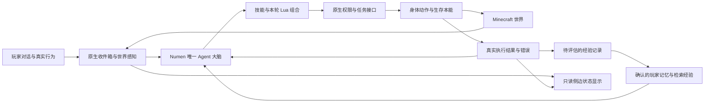

# MC 陪玩 Agent：组员开始前先读

本项目的主方向是：**让一个真实存在于 Minecraft 世界中的 NPC，理解玩家意图、共同完成游戏目标，并从反馈中改善协作。** 当前以 Minecraft Java 1.21.1 + Fabric 为唯一交付目标。它是基于 Numen 的课程研究衍生工程，不是从零开发的大模型，也不是 Numen 官方发行版。

团队仓库：[Twilight429/mc-companion-agent](https://github.com/Twilight429/mc-companion-agent)，开发基线分支为 `1.21.1`。

## 从哪里开始

1. 按 [构建与协作指南](docs/TEAM_BUILD.md) 在自己的电脑编译并进入游戏。
2. 阅读 [五个扩展方向](docs/TEAM_EXTENSIONS.md)，自选一个主方向；先与负责人确认认领，避免同时修改同一模块。
3. 先交一个能在游戏中看到差异的小功能，再增加模型、记忆或实验复杂度。
4. 每项成果至少包含：代码、一个可复现场景、对照结果、一次短演示、已知问题。不能只提交 AI 生成的说明文档。

## 当前具备什么

| 层次 | 已有基础 | 当前边界 |
|---|---|---|
| Agent | Numen 原生服务端循环、模型配置、Lua 工具、技能、目标与动作回执 | 真实 LLM 的长时自主生存和建造稳定性仍需持续测量 |
| 世界行动 | 原生感知、寻路、挖掘、合成、容器、建造与生存本能 | 不通过管理指令伪造采集、物品或任务完成 |
| 建筑协作 | 本地模板检索、AI 草稿、投影定位、确认、分批施工、材料调查、已完成格保护 | 外部建筑文件自行合法取得，不随源码分发；可见资源不等于库存 |
| 玩家信息 | `plugins/sceneadapt` 中的确认式偏好、协作提议、反馈统计与隔离存储 | 行为推断、稳定偏好学习和效果评估有待深化 |
| 互动显示 | 原生对话、回应式互动、侧边悬停的同伴状态/材料进度 | 浮窗只显示，不拥有调度权；改变目标直接对话 |

2026-10-25 原工作区基线：2037 项单元测试、24 项 Fabric 端到端测试通过。端到端测试使用模拟模型驱动真实游戏服务器，不能据此宣称真实大模型能稳定完成所有游戏目标。团队快照的复核结果另见 [团队快照验证](docs/TEAM_VERIFICATION.md)。

## 一个大脑，复用已有执行层

新增技能组合已有接口；确实缺少原子能力时才增加 Java API。不得为某个方向另开一套持续调用 LLM 的调度器。身体控制、权限、世界感知与结果记录仍保持一个来源。RL 不是本轮扩展的前置条件；先完成可观察、可评估的协作闭环。

## 四人如何推进

- 负责人：维护稳定分支、接口评审、集成与验收；可继续主攻玩家模型。避免同时承包所有功能。
- 其余三位：各认领一个独立方向；优先选择“采集与生存协作”“执行经验与失败恢复”“陪玩互动”。也可用“实验评测”替换其中一个。
- “玩家适应”可由负责人推进，或交给愿意深入数据建模的成员。五个方向是自选菜单，不要求四人全部完成。
- 每位实现者负责自己方向的实验；评测方向负责统一工具与统计，不能成为其他人不做验证的理由。

## 学术与来源

核心工程来自 [Dwinovo 与贡献者的 Numen](https://github.com/Dwinovo/minecraft-numen)，代码基线 `daae0f14a00dfa8ab302683e93609cc862bf0798`。核心源码与修改遵循根目录 `LICENSE`（LGPL-3.0-only），保留上游署名。完整来源、独立占位资源与未分发内容见 [来源与分发边界](docs/TEAM_PROVENANCE.md)。

上游架构可从 [心智模型](docs/architecture-mind-model.md)、[输入与存储](docs/input-pipeline.md)、[Lua 与工具](docs/shell.md)、[空间感知](docs/spatial-perception.md)、[权限层](docs/permission-layer.md) 按需阅读；先理解接口，再让 AI coding 工具生成代码。
