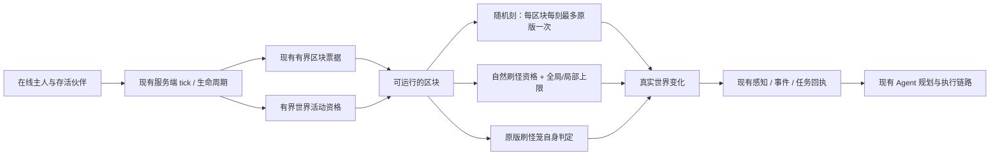

# NPC 参与世界模拟的改动方案

日期：2026-10-28  
适用范围：当前主工程，Minecraft Java 1.21.1 + Fabric  
状态：**待办设计，暂缓实施。本次只形成方案，不修改运行代码、配置、Mod 或存档。**

## 1. 判断与优先级

这是可控范围内的游戏运行机制改动，不需要重写 Agent、替换假玩家身体或训练新模型。直接影响集中在服务端区块与玩家在场判定；整体链路的主要风险来自新增世界活动带来的性能、怪物威胁和事件增多。

建议当前优先级为**低至中，放入后续独立迭代**。现阶段陪玩家建造、采集和交互通常有真人在附近，不必为“NPC 完全像真人一样驱动世界”提前扩大范围。等出现明确的离队耕作、独立探索或远程刷怪任务，再实施对应阶段。

以一名熟悉本工程的开发者估算：

| 交付范围 | 估计工作量 | 能解决什么 |
| --- | --- | --- |
| 只完成基线诊断 | 0.5–1 人日 | 确认刷怪笼问题是否真实存在，分清加载、随机刻和刷怪判定 |
| 诊断 + 有界随机刻恢复 | 合计约 1.5–3 人日 | 为后续离队种植等任务提供基础；普通刷怪笼仅在复现出问题后修复 |
| 有界世界活动完整版本 | 合计约 4–7 人日 | 包括自然刷怪、刷怪上限、生命周期、多人重叠和回归验证 |
| 再扩展 Paper / NeoForge 或模组刷怪器 | 另估 | 不计入上述预算，不能承诺相同行为自动成立 |

以上是源码研判后的工程估算，包含实现、检查和测试，不是已经完成或测得的工时。若开发者不熟悉 Minecraft 的区块票据与 Mixin，需额外留出学习时间。AI coding 可以缩短编码时间，不能替代原版机制核对和运行验证。

## 2. 已确认的现状与尚未确认的问题

### 2.1 身体确实是假玩家，但并非普通 Mob

`NumenPlayer` 继承原版 `ServerPlayer`，因此“假玩家”描述的是没有真实网络客户端的服务端玩家身体，不等于没有玩家能力。

### 2.2 当前主动取消了原版玩家区块管理

`ChunkMapCompanionMixin` 包含两种不同目的：

- 在 `skipPlayer` 中对伙伴返回 true，使它不进入正常玩家的距离管理和加载票据流程。
- 在 `applyChunkTrackingView` 中取消区块视图处理，避免向不存在的客户端发送区块包。

第二项是合理的传输优化；第一项还影响世界模拟所依赖的玩家计数。**后续应拆开这些职责，不能直接删除整个 Mixin。**

`CompanionChunkLoader` 通过自定义区域票据补回有界加载。当前票据参数 `RADIUS = 3` 不表示“7×7 都正常运行”，按 1.21.1 的票据等级传播，应分别理解为：

| 区域 | 当前设计含义 |
| --- | --- |
| 核心 3×3 区块 | 实体可运行 |
| 外围至 5×5 区块 | 方块运行等级，不能等同于实体运行 |
| 外围至 7×7 区块 | 可加载的外围，不能等同于完整世界模拟 |

上表是加载等级的几何范围，不保证对应区域的每种游戏活动都实际执行。随机刻、自然刷怪等还有额外门槛，边界行为须由运行测试确认。

票据每 20 个游戏刻续期，超时为 40 个游戏刻；离开后的卸载还需要等待距离传播及实际卸载过程，不能承诺严格两秒内全部卸载。

### 2.3 自然刷怪与随机刻确有共同限制

对照本地 1.21.1 映射源码，`ServerChunkCache.tickChunks` 在部分区块活动前检查：

- 区块是否允许实体活动；
- `ChunkMap.anyPlayerCloseEnoughForSpawning` 是否成立。

后者又依赖 `DistanceManager.hasPlayersNearby`。伙伴被排除出正常距离管理后，仅靠自定义加载票据不能补齐这个条件。该版本中随机刻也位于这条外层门槛之内。

因此，“区块存在且 NPC 能走进去”与“作物生长、自然刷怪照常发生”不是同一件事。

### 2.4 普通刷怪笼不能直接归为上述问题

普通刷怪笼的 `BaseSpawner` 调用 `hasNearbyAlivePlayer`，默认检查附近存活、非旁观者玩家；这条逻辑不同于自然刷怪的距离管理流程。

现有代码未发现专门排除 Numen 的普通刷怪笼判定。因此：

- **尚未证明普通刷怪笼需要修改。**
- 先检查 NPC 所处维度、距离、存活状态、刷怪笼所在区块的运行等级、生成条件、难度和附近同类生物数。
- 区分“客户端看到的转动/粒子”和“服务端实际倒计时/生成”。玩家离开后，客户端显示不能直接证明服务端未运行。
- 试炼刷怪笼单独验证：其玩家资格还涉及生存/冒险模式、视线及试炼状态等条件，不能为了让创造模式 NPC 激活它而绕过原版规则。

### 2.5 主人离线策略保持现状

当前 `CompanionTickDispatcher` 只在主人的游戏玩家实体在线时续期加载票据。

`OwnerPresence` 还可能把外部大脑连接或渠道来访算作“主人在场”，这是 Agent 交互层的含义，**不等于已经允许它们长期保活世界区块**。本方案不顺便改变这一策略，也不新增离线挂机能力。

## 3. 推荐目标：有界地参与世界活动

目标不是把每个伙伴变成一位拥有完整视距的额外真人，而是：

1. 保持现有有界加载和无效区块包抑制。
2. 只在伙伴实际活动区域内补齐需要的世界行为。
3. 保留原版难度、游戏规则、玩家游戏模式、距离和生物生成条件。
4. 不重复执行同一个区块的随机刻或刷怪逻辑。
5. 多个伙伴与真人的覆盖区域按集合合并，不按伙伴数量叠加执行。
6. 身体死亡、遣散、换维度、主人离线和服务器停止后，撤销相应影响。

初版不扩大现有加载范围。若小范围自然刷怪效果不足，应如实记录限制，后续单独评估预算，不能默默把加载范围扩成真人视距。

## 4. 改动落点与实现边界

图中“有界世界活动资格”是拟增加的机制，不是第二套 Agent 决策器。不得让 LLM 每刻决定是否加载区块、是否随机刻或是否刷新怪物。

### 4.1 预计涉及的代码位置

| 位置 | 拟处理内容 | 约束 |
| --- | --- | --- |
| `ChunkMapCompanionMixin` | 保留无效区块包抑制；核对玩家距离管理与世界活动资格的分离方式 | 不整体取消现有限制 |
| `CompanionChunkLoader` | 复用实际活动中心和范围；必要时提供可查询的活动区域 | 不复制一套互不一致的加载半径 |
| `CompanionTickDispatcher` / 生命周期入口 | 在现有主线程流程维护资格、处理退出和跨维度 | 不修改任务优先级、反射顺序或任务完成判定 |
| 新的局部世界模拟适配 | 对 `ServerChunkCache`、`ChunkMap`、刷怪上限统计的必要位置做窄范围接入 | 具体注入点须在 P0 后确定 |
| `ServerSettings` | 加一个服主控制的实验开关，默认保持当前行为 | 不新增玩家操作窗口，不交给模型切换 |
| 单元、GameTest、端到端测试 | 验证资格、世界行为、范围、清理及现有协作流程 | 不以修改已有断言代替修复 |

预计约 6–10 个运行代码/配置位置及 2–4 个测试位置，实际数量以诊断结果为准。普通刷怪笼若原本正常，不为它额外增加注入。

### 4.2 随机刻与自然刷怪必须分别处理

1.21.1 存在共享外层门槛，不能简单地把某个布尔值改成 true，就假设二者都已正确恢复。

阶段一若只恢复随机刻，必须明确维持自然刷怪的旧行为，不能依赖“刷怪上限碰巧为零”来阻止生成。实现时应在既有流程中拆分资格，不额外遍历所有区块再调用一遍 `tickChunk`。

### 4.3 自然刷怪必须同时核对三处

自然刷怪至少涉及：

- 候选区块是否拥有有效的附近玩家；
- `LocalMobCapCalculator` 能否得到对应的附近玩家及局部生物计数；
- 全局刷怪上限使用的区块数量。

只放开第一处，可能仍刷不出怪；只增加数量，又可能使 NPC 不合理地抬高整服生物上限。

推荐先采用保守的统计目标：

$$
C_{effective}=C_{vanilla}\cup C_{npc}
$$

其中 `C_vanilla` 保留原版计数语义，`C_npc` 只增加本方案明确允许、实际具备运行条件的伙伴活动区块。按维度去重，重叠区域只计算一次。精确的候选集合与原版上限口径需通过 P0/P2 验证，不能把此式当作已完成实现。

原版全局上限包含与区块计数成比例、取整的因素，可用下式理解：

$$
cap_c=\left\lfloor M_c\frac{|C_{effective}|}{289}\right\rfloor
$$

`M_c` 表示类别基准上限；最终是否生成还受现有生物数、局部上限和位置条件影响。这是机制解释，不是新增一套刷怪规则。

小区域按比例计数时，某些类别新增额度可能很低，甚至取整为零。因此，本方案不承诺“NPC 一个人在远处就能稳定生产所有动物”。

### 4.4 不重新实现原版完整玩家距离管理

原版 `DistanceManager.addPlayer` 同时维护玩家集合、自然刷怪范围、加载和模拟票据。直接调用它再取消部分票据，会引入添加/移除顺序、共享区块和真人重叠的风险。

优先评估在现有有界加载之上补充世界活动适配。只有窄范围接入确实不可维护时，才另行评估更深的距离管理改造，并重新估工时。

## 5. 对整体链路的影响

| 现有链路 | 直接影响 | 需要警惕的间接影响 |
| --- | --- | --- |
| DeepSeek 配置、API 调用和图文请求 | 原则上无需改动 | 世界新增威胁可能增加既有事件和模型调用 |
| 玩家记忆、偏好、自适应 | 无需改模型或存储格式 | 不应把世界活动资格误存成玩家偏好 |
| Lua / skills / 建造和采集接口 | 接口保持兼容 | 作物、怪物或地形变化可能改变任务结果和重规划频率 |
| 寻路与任务执行 | 保持现有控制和快照边界 | 跨区块等待、战斗打断、重试次数可能增加 |
| 权限与建筑保护 | 判定入口保持现状 | 允许刷怪不等于允许 NPC 破坏建筑；生物造成的世界变化需单独观察 |
| 任务展示 UI | 不新增控制界面 | 展示现有真实进度和失败原因，不能重新接管任务 |
| NPC 相机 | 不改变截图接口和获取条件 | 服务端有活动不代表主人客户端已加载远方画面；更多实体可能增加渲染负担 |
| 服务器性能与存档 | 这是主要影响面 | 新区块生成、更多实体、区块保活和卸载保存均可能增加成本 |

结论：**架构改动较局部，运行影响却会沿着真实世界变化传到整个 Agent。** 可以控制兼容风险，不能承诺“完全不影响整体链路”。

## 6. 分阶段实施与工作量

| 阶段 | 工作 | 预计人日 | 退出条件 |
| --- | --- | --- | --- |
| P0：基线与诊断 | 在隔离世界复现普通/试炼刷怪笼，测加载等级、随机刻和自然刷怪判定 | 0.5–1 | 能给每种现象指出实际失败条件；未复现的不强行修复 |
| P1：基础世界活动 | 引入有界资格与默认关闭开关，先恢复随机刻，保留自然刷怪原有行为 | 1–1.5 | 作物实验和生命周期通过，旧行为可恢复 |
| P2：自然刷怪 | 接入附近玩家、局部计数、全局计数和重叠去重 | 1.5–3 | 功能判定和统计一致，原版距离/规则仍有效 |
| P3：集成验证 | 回归协作、相机、换维度/死亡/退出；比较性能并检查回滚 | 1–1.5 | 无泄漏、无重复执行、性能在预算内 |

完整范围合计约 4–7 人日。P0 若证明只存在正常游戏模式/距离问题，可在诊断后直接停止，不产生后续改动成本。P1 若已经满足当前任务，也可以暂不开展 P2。

## 7. 验证设计与可观测指标

以下是拟定验收目标，**不是本次已经运行或通过的实验**。

### 7.1 隔离实验条件

使用可丢弃的正常世界副本或专用测试世界，控制难度、游戏规则、时间、光照和生成空间。准备：

- 真人靠近、远离但仍在线、离线三类对照；
- 生存、创造、旁观者的资格对照；
- 同维度、跨维度、死亡复活、遣散、重进世界；
- 0、1、4 个伙伴，以及伙伴彼此重叠/分散；
- 使用可控模型或脚本固定行为，先隔离世界机制，再验证真实 Agent。

测试期间不要改变正式存档或绑定真实付费模型来观察纯世界机制。

### 7.2 功能验收

| 项目 | 方法与预期 |
| --- | --- |
| 普通刷怪笼 | NPC 在范围内、真人远离时检查服务端倒计时及符合条件的实际生成；出范围/旁观/死亡应符合原版规则 |
| 试炼刷怪笼 | 分别验证生存和创造资格、距离及视线，保留原版参与者与试炼状态逻辑 |
| 随机刻 | 用可计数的随机刻测试方块确认执行，再用作物作体验验证；不能要求一次短实验里每株必定成熟 |
| 自然刷怪 | 先验证候选区块、附近玩家列表和上下限；再在合适的黑暗平台上做多次固定时长试验，记录分布 |
| 24 格排除范围 | 测试平台应在原版近距离排除范围之外，同时处于实际可运行区；不能把小加载区内无合格位置误判为算法失败 |
| 区域重叠 | 两个伙伴或真人重叠时，随机刻次数与同一区块单次原版执行一致；统计按集合去重 |
| 生命周期 | 退出、死亡、遣散和跨维度后资格撤销；原位置票据正常到期；单机切存档不残留前一世界的资格 |
| 既有链路 | 同样的建造/采集/跟随/聊天脚本能完成；相机继续返回正确视点或如实报告无图 |
| 传输 | 假玩家无效区块数据包抑制仍有效，不能恢复成给假连接持续发送整圈地形 |

自然刷怪是随机过程，应记录成功次数、条件和时间，不用“某一次没出怪”作为唯一失败判据；生物数量也不应要求精确一致。

### 7.3 性能验收

在相同地形、相同脚本和相同配置下比较开关前后，各重复至少 3 次；冷启动生成新地形与已生成地形分别统计。

初始预算目标：

- 1 个远离真人的伙伴：p95 服务端单刻耗时增量不超过 `max(2 ms, 基线×10%)`。
- 4 个分散伙伴：增量不超过 `max(5 ms, 基线×20%)`。
- 同时检查总单刻耗时是否满足 20 TPS 所需预算；若基线本来超载，不能据此宣称达标。
- 无负载场景下，同样的脚本不能因这项机制自身而每刻触发 LLM；引入真实怪物后的额外调用单独记录。
- 记录区块数量、活动实体数和退出后的回落；排除出生区块、其他玩家、强加载和保存延迟等因素后，不能持续增长。

这些阈值是待校准的项目预算，不是性能保证；若增加加载范围，必须重新测量和估算。

## 8. 范围与收益上的主要风险

1. **小范围与自然刷怪效果存在矛盾。** 核心 3×3 区块中，靠近 NPC 的大量位置落在近距离不刷怪区；自然刷怪的可用区域可能很小。不能把“恢复资格”等同于“效果与真人 8 区块范围相同”。
2. **刷怪上限影响全服。** 即使只想改善一个伙伴，也必须看真人的刷怪效率是否被意外改变。
3. **世界变活会改变已有任务。** 遭遇战增多、作物长大、实体阻路等都可能增加打断；这些是真实玩法变化，不完全是链路故障。
4. **版本内部注入易受升级影响。** 此方案只按 1.21.1 Fabric 核对，未来升级须重新检查调用位置和计数语义。
5. **第三方模组可能主动排除假玩家。** 原版兼容通过不等于所有机器、领地插件、模组刷怪器都兼容。
6. **不能顺便扩大离线能力。** 外部大脑连接是否允许保活区块，必须以后作为独立产品决策。

## 9. 发布与回滚

- 只做一个独立功能迭代，和 Agent 提示词、UI、视觉策略分开提交与验收。
- 只新增一个服主控制的实验开关，默认关闭；旧配置缺少该项时保持原行为。
- 开关读取的运行状态与实际票据保持一致；不建议在未验证生命周期前支持游戏中即时切换，初版可要求重启世界。
- 不改变玩家身份、伙伴 UUID、背包、建筑文件或世界方块的数据格式。
- 关闭开关或恢复上一版 Mod 后，停止新增资格与票据维护；等待已有票据到期和区块正常卸载。
- 已经生成的怪物、长大的作物等是真实世界变化，**回滚代码不会自动撤销它们**。因此验收先在副本进行。

## 10. 何时值得开始

满足以下任一具体需求时再排期：

- 玩家持续离开，伙伴必须独立种植并等待作物成熟；
- 需要研究伙伴独立探索时真实的生存压力；
- 已复现普通刷怪笼在满足原版条件后仍不能被伙伴激活；
- 研究实验需要对比“真人与伙伴能否驱动相同世界机制”。

当前建议：保留本方案，不修改已经可用的版本。优先稳定玩家交流、协作建造、任务反馈和新接入的视觉输入；需要世界机制支撑时，先投入 P0 的 0.5–1 人日，再决定是否完整实施。

## 11. 核对依据

本方案基于本地主工程源码与缓存的 Minecraft 1.21.1 映射源码进行静态核对，未在本次执行新一轮世界行为实验。

项目位置：

- [假玩家身体](../numen-api/common/src/main/java/com/dwinovo/numen/api/entity/NumenPlayer.java)
- [玩家区块管理排除](../numen-api/common/src/main/java/com/dwinovo/numen/api/mixin/inject/ChunkMapCompanionMixin.java)
- [有界区块加载](../numen-api/common/src/main/java/com/dwinovo/numen/api/entity/CompanionChunkLoader.java)
- [主线程续票与生命周期上下文](../numen-api/common/src/main/java/com/dwinovo/numen/api/task/CompanionTickDispatcher.java)
- [主人在场语义](../numen-api/common/src/main/java/com/dwinovo/numen/api/brain/OwnerPresence.java)
- [现有服务器设置](../numen-api/common/src/main/java/com/dwinovo/numen/api/config/ServerSettings.java)
- [当前相机请求](../numen-api/common/src/main/java/com/dwinovo/numen/api/brain/NpcCamera.java)
- [Paper 侧现有行为差异记录](paper.md)

Minecraft 源码核对点：`BaseSpawner.isNearPlayer/serverTick`、`EntityGetter.hasNearbyAlivePlayer`、`PlayerDetector`、`ServerChunkCache.tickChunks`、`ChunkMap.anyPlayerCloseEnoughForSpawning/getPlayersCloseForSpawning`、`DistanceManager.addPlayer/removePlayer/getNaturalSpawnChunkCount`、`LocalMobCapCalculator`。最终实现需再次对照 Fabric 映射与真实运行结果。
